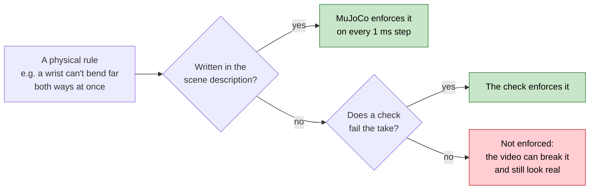
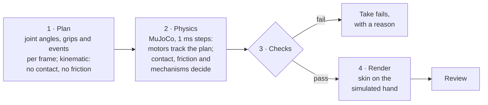
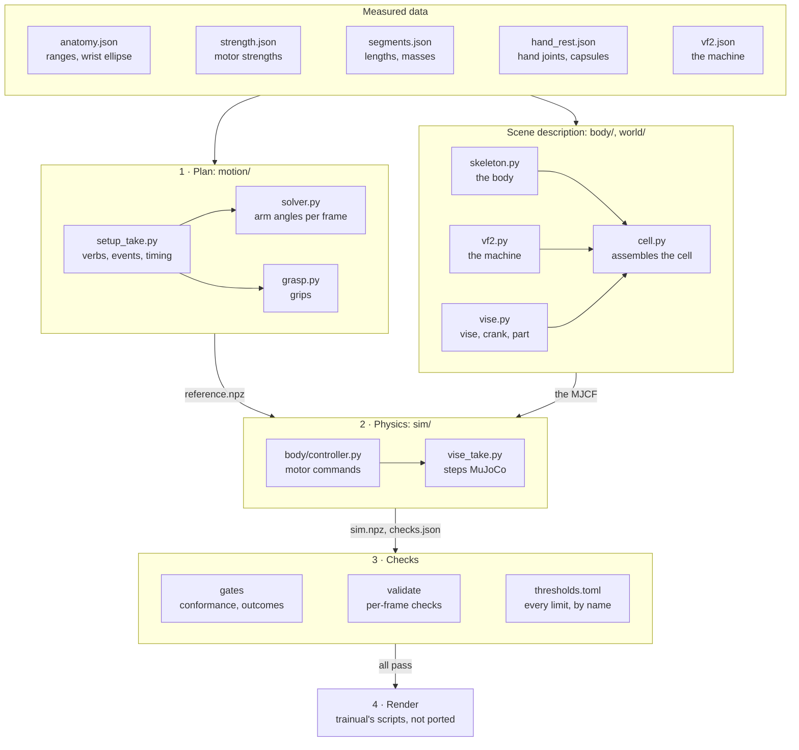
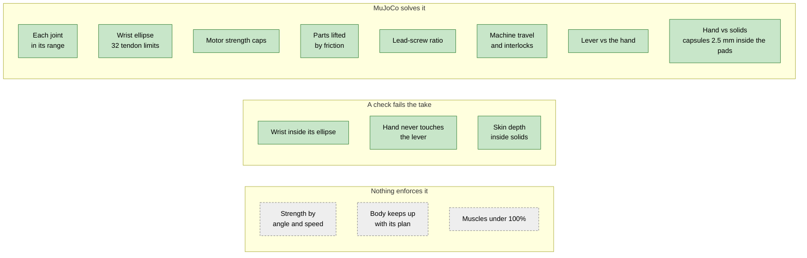
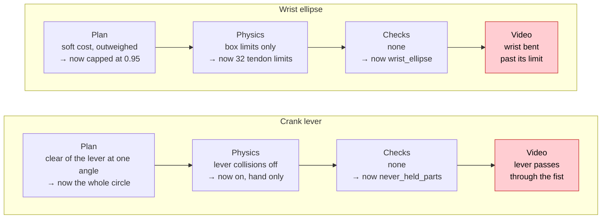
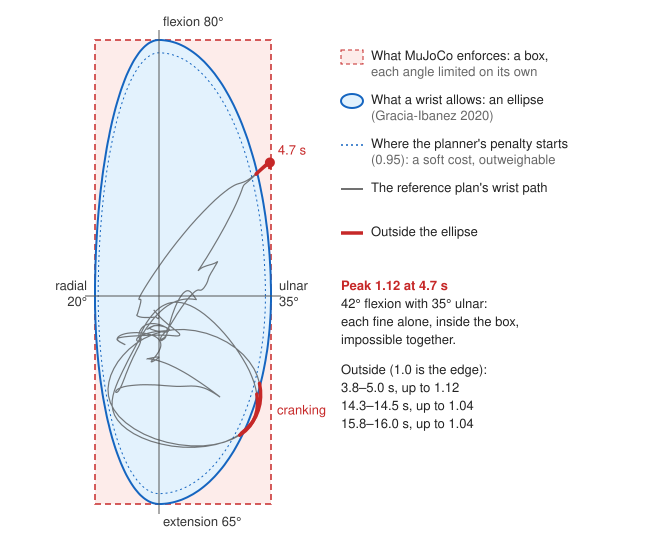
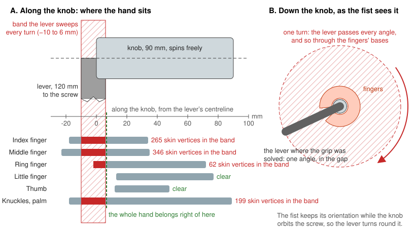
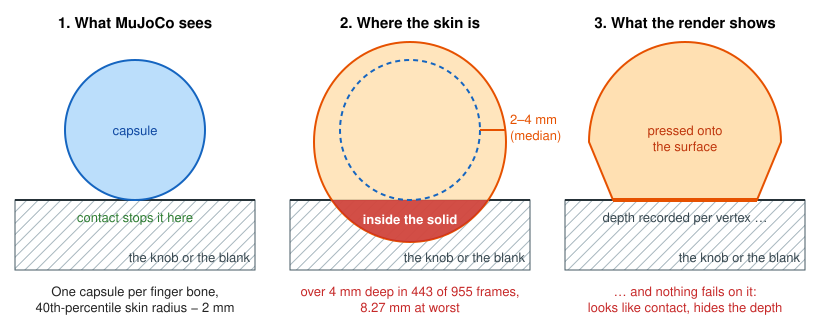

# Moonshot physics: what a take is held to, and what enforces it

**As-built, verified 2026-11-02**, on the re-planned vise take run in the VF-2 cell. Strategy and the checks' thresholds are in
[shop-and-pipeline-plan.md §3 and §5](shop-and-pipeline-plan.md#5-checks-and-tests); tasks in
[checklist.md](checklist.md).

**The principle: MuJoCo enforces only what our scene description tells it.** That description (MuJoCo calls it the
model; nothing to do with Claude) is the MJCF our code writes. MuJoCo solves contact, friction and force for exactly
what is written there, and nothing else.

## How a take is made

**A faithful replay is not a check.** When the plan asks for something impossible and the scene description has no
rule against it, the physics reproduces it exactly. `python -m moonshot.validate.take <take>` runs every check and
exits non-zero unless all pass; a check with nothing to read fails. The render is still trainual's scripts, run by
hand after it passes: nothing in code stops a render yet.

## Where it lives in the code

Paths are under `moonshot/`.

| Stage | File | Its part in the physics |
|---|---|---|
| Data | [`anatomy.json`](../../moonshot/body/data/anatomy.json) | Joint ranges, and the wrist ellipse's four axes |
| | [`strength.json`](../../moonshot/body/data/strength.json), [`segments.json`](../../moonshot/body/data/segments.json) | Peak strength per motor (its `forcerange`); segment lengths and masses |
| | [`hand_rest.json`](../../moonshot/body/data/hand_rest.json) | Hand joints and one collision capsule per bone, reduced from NIMBLE by [`derive_hand.py`](../../moonshot/body/derive_hand.py) |
| | [`vf2.json`](../../moonshot/library/stations/vf2.json) | The VF-2's colliders, travel and speeds |
| | [`thresholds.toml`](../../moonshot/thresholds.toml) | Every pass/fail number, read by name through [`thresholds.py`](../../moonshot/contracts/thresholds.py) |
| Plan | [`setup_take.py`](../../moonshot/motion/setup_take.py) | The take: verbs, events and timing; calls both solvers; writes `reference.npz` |
| | [`solver.py`](../../moonshot/motion/solver.py) | Trunk and arm angles for every frame at once; `wrist_inside` keeps the wrist at 0.95 on its ellipse at most, by construction |
| | [`grasp.py`](../../moonshot/motion/grasp.py) | Each grip: the NIMBLE skin kept out of the colliders it's given, and only those. The knob's include the whole circle the lever sweeps |
| | [`kinematics.py`](../../moonshot/motion/kinematics.py), [`arm.py`](../../moonshot/motion/arm.py), [`hand.py`](../../moonshot/body/hand.py), [`nimble.py`](../../moonshot/body/nimble.py) | Geometry: trunk and arm, the hand's anatomical joints, the skin |
| | [`loads.py`](../../moonshot/motion/loads.py) | What the vise holds, from the process plan |
| Scene | [`skeleton.py`](../../moonshot/body/skeleton.py) | The body: segments, joint limits, the wrist ellipse as 32 tendon limits, motors, couplings, hand capsules |
| | [`cell.py`](../../moonshot/world/cell.py) | The cell: floor, machine, the vise on its table, loose objects, around the body |
| | [`vf2.py`](../../moonshot/world/vf2.py) | The VF-2's axes, doors and spindle, and its control logic (`Control`) |
| | [`vise.py`](../../moonshot/world/vise.py) | Vise, crank, lead-screw equality, part, parallels, and the `enclose` and `keep_para_*` shortcuts. The lever collides with the hand only |
| Physics | [`vise_take.py`](../../moonshot/sim/vise_take.py) | Steps MuJoCo at 1 ms; phase logic per event; switches the shortcuts; writes `sim.npz` and `checks.json` (what the hand touches, each frame) |
| | [`controller.py`](../../moonshot/body/controller.py) | Each motor's command: position servo plus inverse-dynamics feedforward, capped at its strength |
| | [`reference.py`](../../moonshot/sim/reference.py) | The plan as splines: position, velocity and acceleration at any instant |
| Checks | [`test_body_conformance.py`](../../moonshot/tests/gates/test_body_conformance.py), [`test_vf2_conformance.py`](../../moonshot/tests/gates/test_vf2_conformance.py), [`test_cell_conformance.py`](../../moonshot/tests/gates/test_cell_conformance.py) | The scene description says what the data says |
| | [`test_reference_take.py`](../../moonshot/tests/gates/test_reference_take.py), [`test_vise_take.py`](../../moonshot/tests/gates/test_vise_take.py) | The run: tracking, then each verb's outcome |
| | [`test_wrist_ellipse.py`](../../moonshot/tests/gates/test_wrist_ellipse.py) | Driven at full strength in 12 directions, each wrist stops on its ellipse |
| | [`registry.py`](../../moonshot/validate/registry.py), [`test_checks_prove_themselves.py`](../../moonshot/tests/gates/test_checks_prove_themselves.py) | Every per-frame check registers with the bad and good takes it must fail and pass |
| | [`body.py`](../../moonshot/validate/body.py), [`contact.py`](../../moonshot/validate/contact.py), [`penetration.py`](../../moonshot/validate/penetration.py) with [`skin.py`](../../moonshot/validate/skin.py) | The per-frame checks: the wrist inside its ellipse; no part the hand never holds touched (the lever); NIMBLE's skin, posed from `sim.npz`, no deeper inside a solid than the limit |
| | [`take.py`](../../moonshot/validate/take.py), [`test_take_checks.py`](../../moonshot/tests/gates/test_take_checks.py) | Runs them all on a take before it is rendered |
| Render | trainual's `motion/skin_bake.py` and `blender/showcase_physics.py` | Not ported |

## The rules

Green holds, yellow is partial, red fails, grey is not modelled. Outcomes in the green row are also asserted by the
gates in the table above.

| Rule | Modelled as | Status on the re-planned take |
|---|---|---|
| Each joint within its range | MuJoCo joint limits | Holds |
| **Wrist flexion and deviation limit each other** (an ellipse, Gracia-Ibanez 2020) | 32 tangent tendon limits per wrist, at most 0.5% outside it; the planner caps the wrist at 0.95 | Holds: the plan 0.95 at most, the physics run 0.96. trainual's plan reached 1.12. [Figure 1](#1-the-wrist) |
| Motor strength | `forcerange` per motor | Holds: no motor at full strength; 14 of 23 strengths are *proposed* |
| Strength by angle and speed | Not modelled | Gap |
| **The hand doesn't pass through solids** | A capsule per finger bone; a phalanx's centred in its skin, 2.5 mm inside the pad (the pads' compression); the palm's round its bone | Holds: the skin 3.45 mm at worst inside what the hand holds (the fingertips during the 30 N push), against 3.5. With capsules round the bones it was 6.48 mm. [Figure 3](#3-the-skin) |
| **The hand doesn't pass through mechanism parts** | The lever collides with the hand; the knob grip is solved clear of the whole circle it sweeps | Holds: no frame touches it. The draft wrapped it with 872 skin vertices. [Figure 2](#2-the-crank) |
| Parts lifted by friction, without slip | Skin friction 0.6 (Seo & Armstrong 2009), grip-force regulation | Holds: 13.0 / 14.0 N, 1.76 mm of slip against 2.0 |
| Mechanisms obey their ratios | The lead screw as a joint equality | Holds |
| The machine within spec, and its interlocks | Servos capped at rapid speed; `vf2.Control` | Holds |
| The body keeps up with its plan | Lag measured, not gated | Gap: 39 mm against 10 mm |
| Muscles under 100% | MyoSuite replay, not built | Gap |

## The three failures, before and after

How the two broken rules reached the 2026-11-01 render, stage by stage, and what stops each now:

### 1. The wrist

Each plan's wrist path, from its `reference.npz`. At trainual's peak each angle is fine alone and impossible together.

### 2. The crank

Each part's skin along the knob, at its worst over the crank. Clear of the lever, a power grip needs about 113 mm of the
90 mm knob, so the re-planned grip wraps middle, ring and little and rests the index and thumb on it; the little finger
reaches past the knob's free end.

### 3. The skin

Schematic. The physics hand is thinner than the rendered one, and the bake hides the difference; the check measures
the skin itself (`validate/skin.py`), and agrees with the bake on the 2026-11-01 draft (7.93 mm, the bake 8.27). The
figure's numbers are the draft's; the re-planned take's are in the rules table.

## Declared shortcuts

Each holds something in place whatever the geometry it stands in for, so each needs a check against that geometry.

| Shortcut | Stands in for | What it hid | Checked by |
|---|---|---|---|
| `enclose`: a soft connect from the knob to the hand while cranking, where the grip was planned | Flesh conforming round the knob, which capsules can't | It held the knob wherever the hand was, including wrapped round the lever's joint, and 5 mm nearer the lever than planned | `never_held_parts` for the lever; the skin depth for the knob |
| `screw_lock`: the crank locked while not driven | The lead screw self-locking under clamp load | — | Nothing yet |
| `keep_para_*`: parallels welded to the table until checked | Parallels resting under their own friction | — | Nothing yet |

## Withdrawn

- **Withdrawn:** trainual's accepted take as the realism bar. It's wrong because it breaks the wrist ellipse and
  grips the crank at the lever's joint (found on review, 2026-11-01). Its per-verb outcomes stay the bar, now held by
  the re-planned take.
- **Withdrawn:** rendering a draft before its per-frame checks run. It's wrong because review then catches what a
  check should have (2026-11-01).
- **Withdrawn:** the reference's skin depth as 1.52 mm ([§5.1](shop-and-pipeline-plan.md#51-physics-checked-in-mujoco-on-every-frame)).
  It's wrong because that was measured against the table alone; against the knob it's 8.27 mm.
- **Withdrawn:** a five-digit knob grip with the index from 28 mm along the knob (trainual's). It's wrong because it
  only closes with the knuckles behind the lever (2026-11-02).
- **Withdrawn:** 1.0 mm as the skin's limit. It's wrong because it was measured on trainual's rigid-skinned hand,
  and a pad compresses 2–3 mm under 5 N; 3.5 mm, decided 2026-11-02.
- **Withdrawn:** the skin's own hulls as drop-in physics fingers (2026-11-02). It's wrong because the grasp's
  approach and closure were tuned to capsules inside the skin: skin-sized fingers touch the blank early and lightly,
  the arm backs off, and the grab fails.
