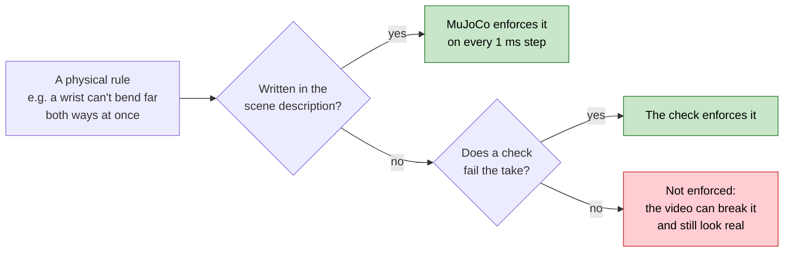
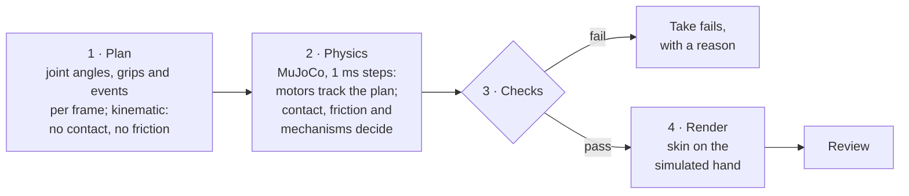
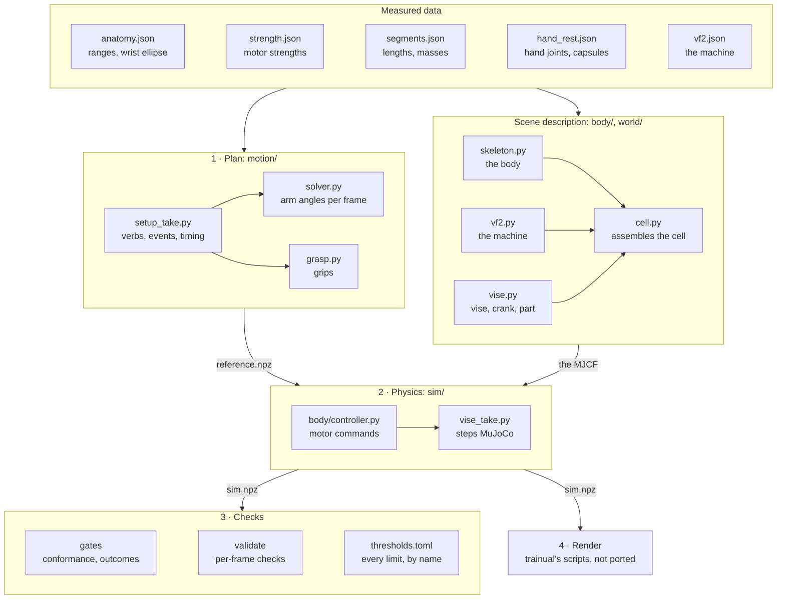
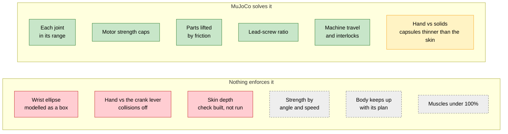
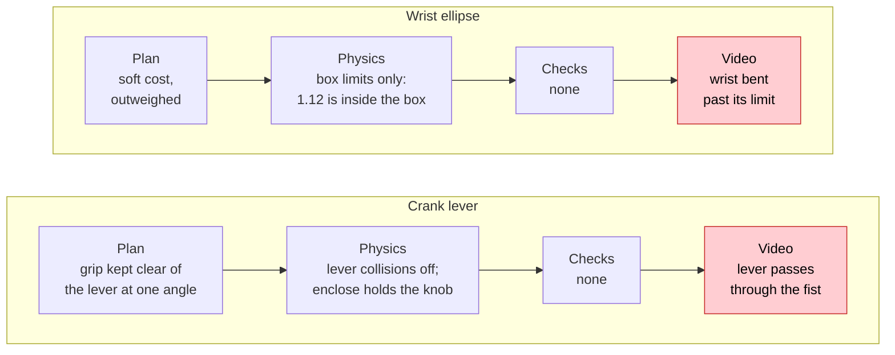

# Moonshot physics: what a take is held to, and what enforces it

**As-built, verified 2026-11-02**, on the vise take run in the VF-2 cell. Strategy and the checks' thresholds are in
[shop-and-pipeline-plan.md §3 and §5](shop-and-pipeline-plan.md#5-checks-and-tests); tasks in
[checklist.md](checklist.md).

**The principle: MuJoCo enforces only what our scene description tells it.** That description (MuJoCo calls it the
model; nothing to do with Claude) is the MJCF our code writes. MuJoCo solves contact, friction and force for exactly
what is written there, and nothing else.

## How a take is made

**A faithful replay is not a check.** When the plan asks for something impossible and the scene description has no
rule against it, the physics reproduces it exactly. The order above, checks before render, is process; no code
enforces it yet.

## Where it lives in the code

Paths are under `moonshot/`.

| Stage | File | Its part in the physics |
|---|---|---|
| Data | [`anatomy.json`](../../moonshot/body/data/anatomy.json) | Joint ranges, and the wrist ellipse's four axes |
| | [`strength.json`](../../moonshot/body/data/strength.json), [`segments.json`](../../moonshot/body/data/segments.json) | Peak strength per motor (its `forcerange`); segment lengths and masses |
| | [`hand_rest.json`](../../moonshot/body/data/hand_rest.json) | Hand joints and one collision capsule per bone, reduced from NIMBLE by [`derive_hand.py`](../../moonshot/body/derive_hand.py) |
| | [`vf2.json`](../../moonshot/library/stations/vf2.json) | The VF-2's colliders, travel and speeds |
| | [`thresholds.toml`](../../moonshot/thresholds.toml) | Every pass/fail number, read by name through [`thresholds.py`](../../moonshot/contracts/thresholds.py) |
| Plan | [`setup_take.py`](../../moonshot/motion/setup_take.py) | The take: verbs, events and timing; calls both solvers; writes `reference.npz` |
| | [`solver.py`](../../moonshot/motion/solver.py) | Trunk and arm angles for every frame at once. **The wrist ellipse is a soft cost here.** |
| | [`grasp.py`](../../moonshot/motion/grasp.py) | Each grip: the NIMBLE skin kept out of the colliders it's given, and only those |
| | [`kinematics.py`](../../moonshot/motion/kinematics.py), [`arm.py`](../../moonshot/motion/arm.py), [`hand.py`](../../moonshot/body/hand.py), [`nimble.py`](../../moonshot/body/nimble.py) | Geometry: trunk and arm, the hand's anatomical joints, the skin |
| | [`loads.py`](../../moonshot/motion/loads.py) | What the vise holds, from the process plan |
| Scene | [`skeleton.py`](../../moonshot/body/skeleton.py) | The body: segments, joint limits (**a box at the wrist**), motors, couplings, hand capsules |
| | [`cell.py`](../../moonshot/world/cell.py) | The cell: floor, machine, the vise on its table, loose objects, around the body |
| | [`vf2.py`](../../moonshot/world/vf2.py) | The VF-2's axes, doors and spindle, and its control logic (`Control`) |
| | [`vise.py`](../../moonshot/world/vise.py) | Vise, crank, lead-screw equality, part, parallels, and the `enclose` and `keep_para_*` shortcuts. **The lever has collisions off.** |
| Physics | [`vise_take.py`](../../moonshot/sim/vise_take.py) | Steps MuJoCo at 1 ms; phase logic per event; switches the shortcuts; writes `sim.npz` |
| | [`controller.py`](../../moonshot/body/controller.py) | Each motor's command: position servo plus inverse-dynamics feedforward, capped at its strength |
| | [`reference.py`](../../moonshot/sim/reference.py) | The plan as splines: position, velocity and acceleration at any instant |
| Checks | [`test_body_conformance.py`](../../moonshot/tests/gates/test_body_conformance.py), [`test_vf2_conformance.py`](../../moonshot/tests/gates/test_vf2_conformance.py), [`test_cell_conformance.py`](../../moonshot/tests/gates/test_cell_conformance.py) | The scene description says what the data says |
| | [`test_reference_take.py`](../../moonshot/tests/gates/test_reference_take.py), [`test_vise_take.py`](../../moonshot/tests/gates/test_vise_take.py) | The run: tracking, then each verb's outcome |
| | [`registry.py`](../../moonshot/validate/registry.py), [`penetration.py`](../../moonshot/validate/penetration.py), [`test_checks_prove_themselves.py`](../../moonshot/tests/gates/test_checks_prove_themselves.py) | Per-frame checks, each proven on a bad and a good take. Skin depth is the only one, and **no take runs it yet** |
| Render | trainual's `motion/skin_bake.py` and `blender/showcase_physics.py` | Not ported |

## The rules

Green holds, yellow is partial, red is broken, grey is not modelled. Outcomes in the green row are also asserted by
the gates in the table above.

| Rule | Modelled as | Status |
|---|---|---|
| Each joint within its range | MuJoCo joint limits | Holds |
| **Wrist flexion and deviation limit each other** (an ellipse, Gracia-Ibanez 2020) | **A box**: each angle on its own | **Broken.** The reference plan reaches 1.12 (1.0 is the edge) at 3.8–5.0 s, holding the blank up, and 1.04 twice while cranking. [Figure 1](#1-the-wrist). |
| Motor strength | `forcerange` per motor | Holds; 14 of 23 strengths are *proposed* |
| Strength by angle and speed | Not modelled | Gap |
| **The hand doesn't pass through solids** | A capsule per finger bone: 40th-percentile skin radius, minus 2 mm | **Partial.** The skin sinks over 4 mm into the blank and the knob in 443 of 955 frames, 8.27 mm at worst; the skin-depth check exists but no take runs it. [Figure 3](#3-the-skin). |
| **The hand doesn't pass through mechanism parts** | The crank lever has collisions off, as trainual built it | **Broken.** The index and middle fingers' bases wrap the lever's root, 872 skin vertices in the band it sweeps. [Figure 2](#2-the-crank). |
| Parts lifted by friction, without slip | Skin friction 0.6 (Seo & Armstrong 2009), grip-force regulation | Holds |
| Mechanisms obey their ratios | The lead screw as a joint equality | Holds |
| The machine within spec, and its interlocks | Servos capped at rapid speed; `vf2.Control` | Holds |
| The body keeps up with its plan | Lag measured, not gated | Gap: 37 mm against 10 mm |
| Muscles under 100% | MyoSuite replay, not built | Gap |

## The three failures, pictured

How both broken rules reached a render, stage by stage:

### 1. The wrist

The reference plan's wrist path, from its `reference.npz`. MuJoCo enforces the box; a wrist allows the ellipse. At the
peak, each angle is fine alone and impossible together.

### 2. The crank

The draft's physics run at 14.0 s; the bars are each part's skin, along the knob. The grip spec placed the fingertips
on the knob and kept the skin clear of the lever at its starting angle only. Relative to the fist, the lever then turns
a full circle.

### 3. The skin

Schematic. The physics hand is thinner than the rendered one, and the render hides the difference.

## Declared shortcuts

Each holds something in place whatever the geometry it stands in for, so each needs a check against that geometry.
None has one yet.

| Shortcut | Stands in for | What it hid |
|---|---|---|
| `enclose`: a soft connect from the knob to the hand while cranking | Flesh conforming round the knob, which capsules can't | It holds the knob wherever the hand is, including wrapped round the lever's joint |
| `screw_lock`: the crank locked while not driven | The lead screw self-locking under clamp load | — |
| `keep_para_*`: parallels welded to the table until checked | Parallels resting under their own friction | — |

## Withdrawn

- **Withdrawn:** trainual's accepted take as the realism bar. It's wrong because it breaks the wrist ellipse and
  grips the crank at the lever's joint (found on review, 2026-11-01). It stays the bar for per-verb outcomes only.
- **Withdrawn:** rendering a draft before its per-frame checks run. It's wrong because review then catches what a
  check should have (2026-11-01).
- **Withdrawn:** the reference's skin depth as 1.52 mm ([§5.1](shop-and-pipeline-plan.md#51-physics-checked-in-mujoco-on-every-frame)).
  It's wrong because that was measured against the table alone; against the knob it's 8.27 mm.
