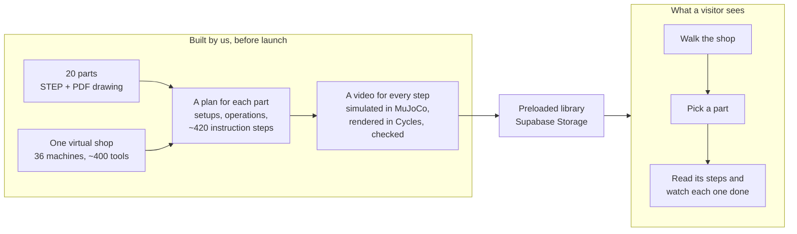
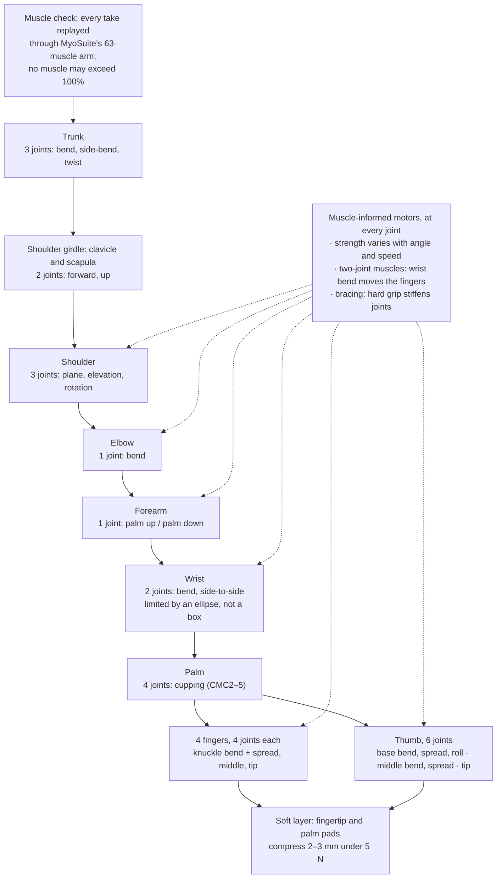
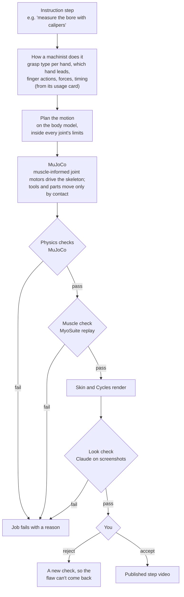
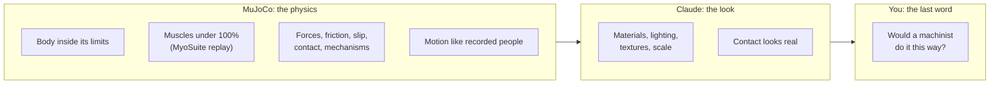
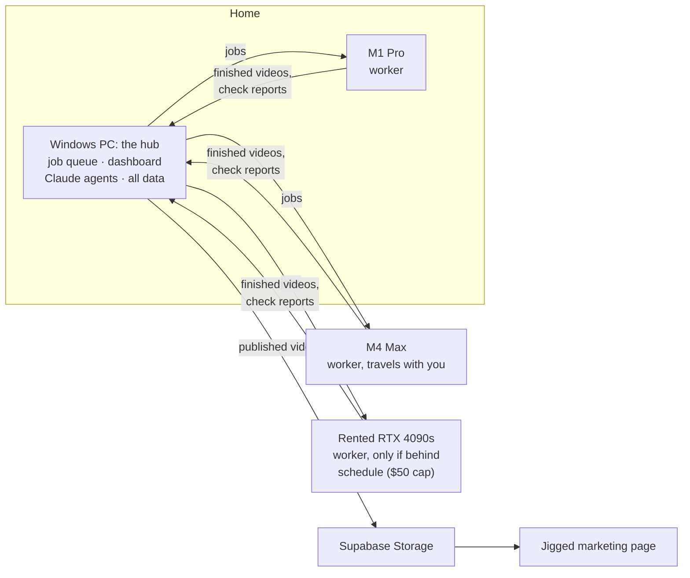
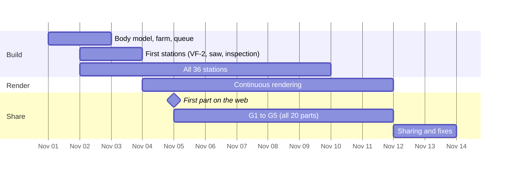
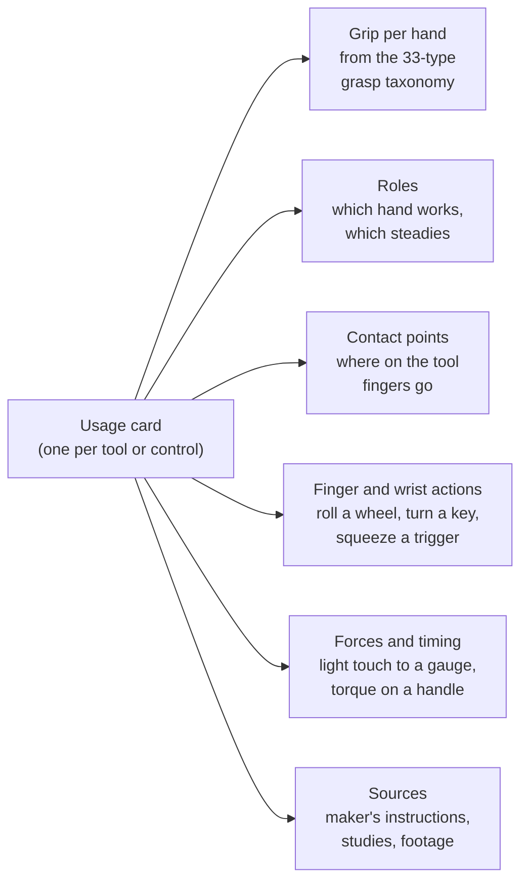
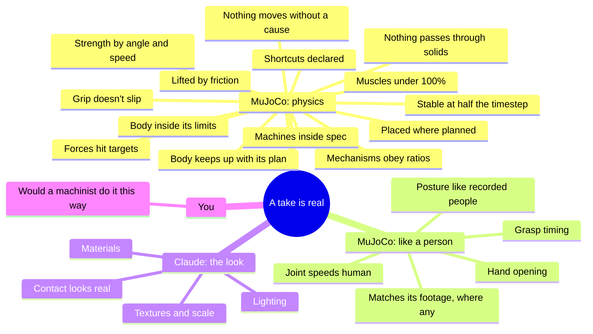
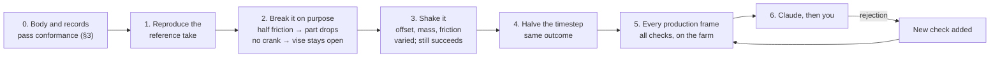

# Moonshot showcase: strategy and architecture (draft 12, 2026-11-01)

Jigged's moonshot is **upskilling trades workers in small shops with AI-generated work instructions**. This showcase
is a **mock** of that tool. We build, ahead of time, the instructions and videos it would produce for 20 real parts
in one virtual shop, and the website presents them. Nothing is generated when a visitor clicks. It is a research
project and a conversation piece, not a product.

**Status:** draft 12, for your review. Tasks and progress live in [checklist.md](checklist.md). The diagrams render
on GitHub; in VS Code they need a Mermaid preview extension.

---

## Overview

### What we're building

- **It's a mock.** The page shows what the real tool would output for a part. The plans, steps and videos are all
  made by us beforehand and preloaded.
- **What is real is the content.** Every motion is simulated on a full human arm-and-hand skeleton in MuJoCo, against
  machines and tools built from their real CAD and spec sheets.

### The body model: the foundation everything else stands on

- **Built like a robot arm.** Every bone is a rigid body with its real length and mass, and every joint is a
  motor. That gives **35 joints per arm, shoulder girdle to fingertip, plus 3 in the trunk**: 73 in all, for two
  arms.
- **Each joint is constrained before anything moves:** its range of motion, top speed and stiffness, all taken from
  published measurements of people. Joints that move together in people, such as the two fingertip joints, are
  coupled.
- **The motors behave like the muscles behind them.** Strength varies with joint angle and speed, as muscle force
  does. The finger flexors cross the wrist, so bending the wrist moves the fingers. Gripping hard stiffens the
  joints.
- **A muscle check catches superhuman effort.** Each take is replayed through MyoSuite's arm (an independent MuJoCo
  model with 63 muscles), which works out how hard each muscle would have to pull. A motion inside every joint
  limit can still need more force than a person has; this fails it.
- **The soft layer** between bone and skin is modelled where it touches things: fingertip and palm pads that
  compress like flesh.
- **The body model is built and tested first** (§3). Nothing is animated: every motion is the motors driving this
  skeleton inside its limits, and objects move only through contact and friction.

### How one instruction step becomes a video

- **Motion comes from how the tool is really used, not a short verb list** (§4). Measuring a bore with calipers is
  a pinch on the beam, a thumb rolling the wheel, jaws closed onto the wall with a light touch, and a read. The
  same structure covers every tool and control in the shop.

### Who judges what

### Where it runs

The hub holds everything; workers hold nothing. Any worker can disappear mid-job, and the hub hands its job to
another.

### When

---

## 1. Decisions

| Topic | Decision |
|---|---|
| What it is | A mock of the instruction tool: 20 parts' plans and videos made ahead of time and preloaded |
| Scope | All 36 stations; the full tool, holder, workholding, inspection, consumable and stock catalogue; all 20 parts |
| Body | A full skeleton from trunk to fingertip in MuJoCo, every joint a muscle-informed motor with human limits; muscles as a check, not the driver (§3.1) |
| Soft tissue | Soft contact pads now; deformable pads only if the trigger in §3.1 fires |
| Physics | Everything with mass is simulated in MuJoCo, machine internals included; light and heat are rendering only |
| Motion | Built from a usage card per tool and control, from makers' instructions, studies and footage where it exists (§4) |
| Judging | MuJoCo checks the physics; Claude checks the look from screenshots; you have the last word |
| Website | A Jigged marketing page: three.js shop, part picker, step player; no visitor control |
| Videos | One per step, 1080p at 24 fps, captions, no voice; Cycles only |
| Rules | Standard safety rules, no PPE; they block a run like a physics failure |
| Code | New, in Jigged (§10); trainual is the reference |
| Compute | Windows hub; both Macs and any rented GPU are workers only |
| Sharing | All 20 parts may be shared with anyone, from mid-build; 7 are private customer parts (L&L) |
| Licences | Non-commercial research licences (GRAB, ARCTIC, MANO, NIMBLE) accepted for research. **Reopen first if this ever becomes product.** |
| Hosting | Videos and published models in Supabase Storage, never the Next build |
| Deadline | Fri Nov 13, sharing included; first part Thu Nov 5 |

## 2. Success criteria

| ID | Criterion | Threshold |
|---|---|---|
| O1 | Complete | All 20 parts; every step has one video and one caption |
| O2 | The part comes out right | Simulated stock within 0.1 mm of the STEP on machined faces |
| O3 | **The body is human** | The body model passes every conformance test in §3.1 |
| O4 | **The physics is real** | Every check in §5.1 passes on every frame |
| O5 | **It moves like a person** | Every check in §5.2 passes |
| O6 | **It looks real** | Claude's look check (§5.3) passes, and you accept the drafts |
| O7 | The procedure is safe | Every action legal in the machine's logic; every safety scenario refused |
| O8 | Captions tell the truth | A caption can only name tools, dimensions and settings that are in the plan |
| O9 | On time | Groups on the web by the dates in §9 |

## 3. The physical model: defined before anything moves

Everything that moves is specified in MuJoCo terms first, and tested against that specification, before a single
step is simulated. The checks in §5 then compare behaviour against these definitions.

### 3.1 The body

**The joints.** Ranges are the active ranges in trainual's anatomy record, each traced to a study.

| Segment | Joints | Range, for example | Source |
|---|---|---|---|
| Trunk | 3: flexion, side-bend, rotation | per the posture data | GRAB, ARCTIC |
| Shoulder girdle | 2: protraction, elevation | in mm of travel | trainual's girdle model |
| Shoulder | 3: plane, elevation, rotation | coupled: the scapula follows elevation | Body-model literature in the anatomy record |
| Elbow | 1 | flexion to about 145° | Anatomy record |
| Forearm | 1: pronation / supination | −82° to 77° | Nizamis 2018 |
| Wrist | 2: flexion / extension, radial / ulnar | 79° / 63°, 19° / 35°, **inside an ellipse** on the dart-thrower plane | Nizamis 2018; Vardakastani 2018 |
| Palm | 4: CMC2–5 flexion (cupping) | arcs of 11 / 7 / 20 / 27°; CMC5 coupled to CMC4 | El-Shennawy 2001 |
| Each finger | 4: MCP flexion and spread, PIP, DIP | MCP about 90°, PIP 100–109°, DIP 70–85°; DIP coupled to PIP | Nizamis 2018; Hayashi 2013 |
| Thumb | 6: CMC flexion, spread, roll; MCP flexion, spread; IP | CMC arcs 45° / 42°; MCP 60°; IP 76–88° | Crisco 2015; Barakat 2013 |

**Each joint also carries:** a top speed (e.g. shoulder 180°/s, elbow 200°/s), stiffness and damping, and its
couplings. **Each bone carries** length and mass from anthropometry.

**Muscles: built into the motors, then used as a check.**

| Layer | What it adds | Source |
|---|---|---|
| **Strength curves** | Each motor's maximum torque varies with joint angle and speed, as muscle force does, instead of one fixed number | Published joint-torque measurements, sourced per joint. trainual's anatomy record has none yet, so this is new work. |
| **Two-joint muscles** | The finger flexors and extensors cross the wrist: bending the wrist back closes the fingers a little, and bending it forward opens them | Tenodesis studies |
| **Bracing** | Joints stiffen with grip effort (co-contraction) | trainual's model, already working |
| **Muscle check** | Each take is replayed through MyoSuite's arm (38 joints, 63 muscles, Apache-2.0). It solves for the muscle activations that produce the motion; the check is in §5.1. | MyoSuite 3.0 |

**Withdrawn:** driving the arm with simulated muscles. It was ruled out because no muscle-driven method has been
shown using a tool, and controlling 63 muscles for a task like cranking is open research
(trainual's hand-interaction research, 2026-10).

**The soft layer between bone and skin:**
- **Now:** soft contact on the fingertip and palm pads, compressing about 2–3 mm under 5 N, with the visible squash
  added in the skin pass.
- **Upgrade, only if triggered:** MuJoCo's deformable bodies for the fingertip and palm pads, so flesh conforms to
  what it holds. **The trigger:** a grip needs a declared assist because rigid fingers can't wrap the object (like
  the vise knob), or you or Claude keep flagging grips as wrong. It costs simulation speed, so it isn't the default.
- **What you see** is NIMBLE's MRI-built hand: bones, 7 muscle groups and skin, so the palm bulks and the knuckles
  change shape. Above the wrist, the operator's sleeves cover most of the forearm.

**Body conformance tests**, run before anything else:

| Test | Passes when |
|---|---|
| Range | Each joint, driven past its limit, stops within 1° of it; the wrist stops on its ellipse |
| Speed | Each joint, commanded faster than its limit, is capped at it |
| Strength | The arm can lift and hold what people can, and can't lift what they can't (e.g. holds a 0.8 kg blank at arm's length, fails a 25 kg one) |
| Strength curves | Grip force falls with the wrist fully bent, and every joint is weaker moving fast than slow, matching the published curves |
| Couplings | DIP follows PIP, CMC5 follows CMC4, the scapula follows shoulder elevation; bending the wrist moves the fingers (two-joint muscles) |
| Muscle check agrees | A take known to be easy needs low effort in MyoSuite; one deliberately made superhuman fails |
| Proportions | Segment lengths, masses and the reach envelope match the anthropometry |
| Gravity | Holding the arm still costs shoulder and elbow torque inside the comfort range |

### 3.2 Machines, tools and parts

Each record defines, before it's used: bodies with mass and inertia (CAD volume × material density); joints with
the maker's travel; motors with the maker's speed and force; friction by material pair; mechanisms (lead screws,
gears, belts) as exact ratios; the control logic and its safety interlocks.

**Record conformance tests:** every motor reaches its spec speed and stops at its limits; every mechanism keeps its
exact ratio; everything at rest stays at rest (no jitter or drift); every interlock blocks what it should.

## 4. How motion is described: a usage card per tool

**Withdrawn:** a fixed list of skills (grab, place, slide, rotate, push, measure) as the vocabulary of operations,
from trainual. It was wrong because it can't express the dexterity real operations need. trainual's "measure" was a
fingertip pressed along a parallel; real measuring is calipers, micrometers, indicators and gauges, each held and
worked differently.

**Instead, every tool and machine control gets a usage card**: a short structured record of how a person uses it,
like a recipe card. The motion planner reads the card and moves the body model to match.

**An example card: digital calipers, measuring a bore**

| Field | Value |
|---|---|
| Grip | Working hand: thumb on the thumb wheel, fingers wrapped round the beam (a lateral-pinch-with-wrap grip). Other hand: steadies the part. |
| Contact points | Thumb pad on the wheel; index and middle fingers under the beam; jaw tips inside the bore |
| Actions | Close the jaws to the bore → insert the inside jaws → thumb rolls the wheel to open until both jaws touch the wall → rock slightly to find the largest reading → read the display → close the jaws and withdraw |
| Forces | Light jaw contact, about 1–2 N; the jaws must not spring |
| Timing | Reach and grasp per the grasp-timing studies; the measurement itself about 3–5 s |
| Sources | The maker's instructions for use; grasp taxonomy; grasp-timing studies; footage if found |

- **An instruction step is a sequence of cards**: pick up the calipers → measure the bore → set them down.
- **Below the cards sit motion phases** shared by all of them: reach, pre-shape, grasp, in-hand adjust, transport,
  operate, release. trainual's seven verbs survive here as building blocks, not as the vocabulary.

**Where the "how" comes from**, since no footage will be recorded for this project:

| Source | Gives | Availability |
|---|---|---|
| **Makers' instructions for use** (Mitutoyo, Starrett, Haas, Kurt…) | The correct grip and sequence, often with photos | Public; always available. **The baseline for every card.** |
| **Published studies** | Grasp types, grasp timing, hand opening, forces (already used in §5.2) | Always available |
| **Research video datasets** with tracked hands, e.g. Ego-Exo4D and AssemblyHands (Meta) | Timing and finger pose for similar hand actions | Sign-up and non-commercial licences, acceptable here (§1). Few, if any, show machining, so it's grounding for generic actions, not per tool. Licences to be confirmed per dataset. |
| **YouTube videos of real machinists** | Timing, grip and finger pose, per tool | Downloaded through a downloader such as downr.org, by your decision (2026-11-01), even though YouTube's terms permit downloading only where a video offers it. **Conditions:** videos stay in the data root (`C:\jigged-data\footage\`), are never committed, published or shown on the site, and only measurements taken from them (timings, finger poses) are kept in the repo. Creative Commons videos are preferred where they exist. This is how trainual measured its vise-setup timing. |
| **Your review** | Whether it looks like a machinist | Every draft |

**Footage is a bonus, not a dependency.** A card is complete from the maker's instructions and the studies; footage,
where found, tightens timing and finger pose. The "matches its footage" check (§5.2) applies only to cards that
have footage.

**The cost:** tens of cards, one per tool family and control type. They're written in station order, so G1's tools
(band saw, VMC controls, calipers, micrometer, indicator) come first.

## 5. Checks and tests

**The reference** is the accepted vise setup take from trainual: 955 frames, MuJoCo 3.17, in
`C:\jigged-data\reference\setup-take\`. The new core must reproduce its outcomes first; the "measured" columns are
that take.

### 5.1 Physics, checked in MuJoCo on every frame

| Check | Threshold | Measured on the reference take | Source |
|---|---|---|---|
| **Body inside its limits** | Every joint within range (1° tolerance) and under its speed and strength limits | **435 frames over by more than 0.5°**, worst index spread 5.4° (fails, §5.5) | §3.1 |
| **Strength by angle and speed** | No joint exceeds its strength curve at its current angle and speed | Not yet checked: the curves are new | §3.1 |
| **Muscles under 100%** | Replayed through MyoSuite, no muscle exceeds 100% activation; holds longer than 5 s stay under 30% (*proposed*) | Not yet checked | MyoSuite 3.0 |
| **Lifting is by friction** | A part lifts only while fingertip friction holds it; grip 1.7–2.2 × the slip force (11–14 N for 0.8 kg) | 12.9 N per side | Guillery 2013; Hiramatsu 2015 |
| **No slip in the grip** | Under 2 mm unless the step slides it (*proposed*) | 1.66 mm through a 28° turn | — |
| **Placed where planned** | Within 2 mm and 1° (*proposed*) | 1.53 mm, 0.0° | — |
| **Forces reach their targets** | Within 5% (*proposed*) | 29.7 N against 30 N | — |
| **Mechanisms obey their ratios** | Jaw travel = turns × lead; clamp force plausible | 2.28 turns, 90 → 75.7 mm; clamp 7,333 N | Kurt spec |
| **Body keeps up with its plan** | Lag under 10 mm (*proposed*); more means physics refused the motion | 6.77 mm | — |
| **Nothing passes through solids** | Collision shapes under 2.5 mm (*proposed*); rendered skin under 1.0 mm | 2.03 mm; skin **1.52 mm into the table** (fails, §5.5) | trainual limit |
| **Nothing moves without a cause** | Every pose change explained by a contact, joint or motor; no velocity spikes or NaN | Not yet checked | New |
| **Stable, not lucky** | Half the timestep changes no outcome past its threshold | Not yet checked | New |
| **Machines stay in spec** | Every axis within the maker's travel, speed and acceleration | Not yet checked | Spec sheets |
| **Shortcuts are declared** | Every non-physical assist is registered and reported with its duration; an undeclared one fails. A grip assist counts toward the deformable-pad trigger (§3.1). | Knob soft constraint 7.37 s; self-locking screw; parallel keepers | trainual report |

### 5.2 Moves like a person, measured in MuJoCo

| Check | Threshold | Measured on the reference take | Source |
|---|---|---|---|
| **Posture like people's** | Trunk-to-wrist angles inside the 1st–99th percentile of 268,845 recorded frames, for 95% of frames (*proposed*) | Trunk rotation outside in 359 of 955 frames (fails, §5.5) | GRAB, ARCTIC |
| **Joint speeds** | Under each joint's limit | Shoulder rotation 154°/s against 150 (fails, §5.5) | Anatomy record |
| **Posture likelihood** | Median at or below people's 95th percentile (about 25) | 24.9 | Posture prior |
| **Grasp timing** | Preload 230 ± 91 ms, loading 214 ± 51 ms; reach-to-grasp inside the measured range (left 0.26–0.62 s, right 0.32–0.67 s) | Not yet checked | Guillery 2013; trainual's measured setup video |
| **Hand opening** | Peaks at 71–77% of the reach; 0.74–0.92 mm wider per mm of object | Not yet checked | Bhatia 2022; Smeets 2020 |
| **Matches its footage** | Only for cards with footage: phase timing and grip match the tracked footage within a band (*proposed*) | Not yet checked | §4 |

### 5.3 The look, checked by Claude from screenshots

- **Who:** the Claude agent sessions on the hub, looking at rendered frames. The pipeline code makes no API calls,
  so CLAUDE.md's rule on AI calls in the app doesn't apply; it costs Claude Code usage.
- **What:** each station from fixed angles once its model lands, against maker photos of the real machine; then
  three frames per step on drafts (first, a contact moment, last).
- **The rubric**, each item pass or fail with a reason:
  - materials read correctly (bare steel, cast iron, paint, aluminium, carbide, plastic);
  - lighting is plausible for a shop, with no blown highlights, noise or fireflies;
  - textures are the right scale, with no stretching, seams or obvious tiling;
  - proportions and scale match the real thing;
  - contact looks real: shadows where fingers meet metal, skin compressed at the pads;
  - captions are legible and the action is in frame.
- **Calibrated against you.** On the first station, you and Claude judge the same frames. If you disagree, the
  rubric is fixed before Claude judges alone.

### 5.4 How the tests prove themselves

Steps 0–4 happen once per body, record, usage card or station before it counts as done. Step 5 runs on every job.
Step 3 targets: nominal 100%, perturbed at least 95% (*proposed*).

### 5.5 Known gaps in the reference take

It fails four checks. The new body model must fix them, or you consciously loosen the threshold:
- finger spread up to 5.4° past range (435 frames);
- skin 1.52 mm into the table;
- shoulder rotation at 154°/s against 150°/s;
- trunk rotation outside the recorded-people range in 359 frames. That data is seated tabletop work, so a
  separate range for standing bench work may be the honest fix.

## 6. Rules for agent-written code

| Tier | What | Runs |
|---|---|---|
| Fast | Data formats, record and body conformance, plan determinism | Hub and CI, every commit; under 3 minutes (*proposed*) |
| Physics | §5.4 steps 1–4 | Farm, before a usage card or station counts as done |
| Production | §5.1–5.2 on every frame | Farm, every job |
| Look and review | §5.3, then you | Drafts, then finals |

**Each rule is enforced by a CI check:**
1. **A change either moves the bar or meets it, never both.** Thresholds, reference outputs and the deliberately
   bad takes live in protected files; a PR may touch those or the code, not both.
2. **Checks never use the code they check.** Penetration is measured on the rendered mesh, not from MuJoCo's own
   contact report; stock is compared to the STEP with OpenCASCADE.
3. **No faked physics** in physics tests, and no flaky tests tolerated.
4. **"Done" means the checks passed**, not that an agent said so.

## 7. The parts

| # | Part | Routing | Steps | Group |
|---|---|---|---|---|
| 1 | **nist-ctc-01**, NIST prismatic test part | band saw → VMC → inspection | 16 | **G1, Thu Nov 5: first shared** |
| 2 | nist-ftc-10, NIST prismatic | VMC → inspection | 12 | G1 |
| 3 | ll-1005337, L&L Delrin pallet inlay | VMC → inspection | 13 | G1 |
| 4 | ct-slbeam, Contour L-block, 4140 | saw → Hurco VM1 → black oxide → QC | 17 | G1, Fri Nov 6 |
| 5 | ll-1007223, L&L gripper jaw, 4140 | saw → VMC → zinc plate → inspection | 17 | G1, Fri Nov 6 |
| 6 | ct-tpg322, Contour carbide insert | surface grinder → quick check | 9 | G2, Sat Nov 7 |
| 7 | ll-1011439, L&L bronze centering pin | lathe → inspection | 11 | G2 |
| 8 | ll-1007224, L&L 6061 spacer | saw → lathe (2 ops) → VMC → inspection | 32 | G2 |
| 9 | mcm-8017t3, McMaster D-profile shaft | saw → lathe → OD grinder → VMC → inspection | 30 | G3, Sun Nov 8 – Mon Nov 9 |
| 10 | nist-ctc-05, NIST round flange | saw → manual lathe → VMC → OD grinder → inspection | 30 | G3 |
| 11 | mcm-8492a054, McMaster drill bushing | lathe → heat treat → OD grinder → hone → inspection | 24 | G3 |
| 12 | mcm-91259a544, McMaster shoulder screw | lathe → thread roller → heat treat → OD grinder → black oxide → inspection | 24 | G3 |
| 13 | ct-8848hn, Contour thread bar | Hurco lathe → grind → Hurco mill → grind → laser marker → QC | 36 | G3 |
| 14 | nist-ftc-09, NIST stainless sheet | sheet laser → inspection | 9 | G4, Tue Nov 10 |
| 15 | ll-1011443, L&L aluminium bracket | sheet laser → press brake → inspection | 15 | G4 |
| 16 | ll-1011604, L&L steel cover | sheet laser → press brake → powder coat → inspection | 18 | G4 |
| 17 | ct-brmb0143, Contour form tool, M2 | grinding → wire EDM → laser marker → QC | 20 | G4 |
| 18 | ct-107w-ngd-3r, Contour groove insert | wire EDM → edge prep → laser marker → quick check | 19 | G4 |
| 19 | ll-1006941, L&L robot pedestal weldment | saw → VMC → MIG weld → powder coat → inspection | 23 | G5, Wed Nov 11 |
| 20 | ct-10004-bcrm, Contour brazed reamer | saw → lathe → knee mill → grind → wire EDM → braze → ANCA | 45 | G5 |
| | **Total** | | **≈ 420** | |

`nist-ctc-01` goes first: it needs only three stations and exercises the VMC chain that 9 of the 20 parts share.

## 8. Compute

| | |
|---|---|
| **Frames** | About 420 steps × 20 s, minus 25–35% reused, at 24 fps ≈ **145,000 frames** |
| **Cost** | Target 7 s per 1080p frame on the M4 Max ≈ **280 M4 Max-hours**; benchmarked on day 1 |
| **Farm** | M4 Max 1.0 + M1 Pro ~0.25 + GTX 1070 ~0.15 (GPU only) ≈ 1.35×; Nov 4–11 ≈ **255 M4 Max-hours** |
| **Closing the gap** | 1. Cycles tuning toward 4–5 s per frame (30–40%, closes it alone) · 2. more reuse · 3. the cloud reserve · 4. an honest cut in a repeated motion |
| **Cloud reserve** | RTX 4090 at about $0.30–0.40/h, about 2.3× an M4 Max: $50 ≈ 250 M4 Max-hours. $50 prepaid, no auto-top-up; rented only if the forecast slips past Nov 11, with your approval. |
| **Job queue** | Our own: SQLite on the hub, polling workers, leases, each worker with its own cache. Timeboxed to Nov 1–2; Flamenco is the fallback, but its single shared folder doesn't suit the travelling M4 Max or cloud workers. |
| **Agents** | All on the hub. Its CPU has 4 cores, so heavy tests go to the Macs. |

**Withdrawn:** the M4 Max as the hub (draft 6), because the agents and data now live on the Windows PC. Also
withdrawn: hybrid CPU+GPU rendering on the hub, because its CPU belongs to the agents.

## 9. Tracks and station order

| Track | What | Stations, with the date each must pass its checks |
|---|---|---|
| A. Core | **Body model first** (§3.1), then records, simulator, planner, checks, queue | Body model Nov 2 |
| B. Catalogue | ~400 tools and consumables from parametric generators | — |
| C1 | Mills | VF-2 (Nov 3), Hurco VM1 (Nov 4), VF-3, Fadal, EC-400, knee mill (Nov 8), drill press |
| C2 | Lathes | ST-25 (Nov 5), manual lathe, thread roller, Hurco TMX8 (Nov 6), Mazak |
| C3 | Grinders | Surface grinder (Nov 5), OD grinder (Nov 6), hone, edge prep (Nov 8), ANCA and Deckel (Nov 9) |
| C4 | Lasers, EDM, brake | Laser marker (Nov 6), sheet laser, press brake, wire EDM (Nov 8), hole popper, etch marker |
| C5 | Saw, weld, braze | Band saw (Nov 3), MIG + table, braze (Nov 9), arbor press, belt sander, bench grinder, TIG |
| C6 | Inspection and support | Inspection bench (Nov 3), CMM, comparator, washer, presetter, blast, finisher, benches |
| D. Usage cards | One per tool family and control type (§4) | In station order, G1's tools first |
| E. Parts and plans | All 20 plans | — |
| F. Web | The marketing page | — |
| G. Render | Drafts, finals, captions | From Nov 4, continuously |

Outside processes (heat treat, plating, coating) are one "send out and receive" station with no machine model.

## 10. Data and code in Jigged

- **Code** lives in `moonshot/` at the repo root, plus the page under `app/(marketing)/`. One directory, because
  Vercel's `excludeFiles` list is capped at 256 characters and has room for exactly one more entry.
- **Python** runs in the `jigged` conda env (CLAUDE.md); Blender scripts run in Blender's own Python.
- **Records and schemas are committed. Big binaries are not**: every Vercel build clones the repo.
- **The data root is `C:\jigged-data`**, outside OneDrive. It holds the vendor CAD originals (1.8 GB, can't be
  fetched again), the private parts, the hand model and arm posture file, the CC0 textures, and the reference
  takes.
- **The farm queue is not Jigged's `ai_jobs` queue** and calls no model, so CLAUDE.md's AI-call rule doesn't bite.

## 11. Open questions

None outstanding.

**Decided 2026-11-01** (you delegated 1 and 2 to my judgement):

| Question | Decision | Why |
|---|---|---|
| The *proposed* thresholds in §5 | **Kept as written.** Each is tightened or loosened only from measured data, as a separate change you are told about (§6, rule 1). | They sit just outside what the reference take achieved, so they pass good work and catch drift. Guessing tighter now would only produce false failures. |
| The four reference-take failures (§5.5) | **Three are fixed by construction:** the new body model's joints stop at their limits and are speed-capped, and the table gets proper collision. **Trunk rotation gets a standing-work range** instead: taken from standing-work data if a dataset has it, otherwise widened with a written reason and flagged for your review. | The new body model makes the first three impossible rather than merely checked. The posture data is seated tabletop work, so holding a standing machinist to it would be the wrong test. |
| Cards against the deadline | **G1's tools first, then group by group** | Shows the method on the first shared part, and the Nov 5 milestone shows whether the pace holds |
| Reference footage | **No recording.** Makers' instructions and studies are the baseline; YouTube videos (downloaded and kept local, under the conditions in §4) and research datasets add timing and finger pose where they exist. | You won't record. YouTube is the richest source of real machinists' hands, and you accept its terms risk for local, unpublished analysis. |
